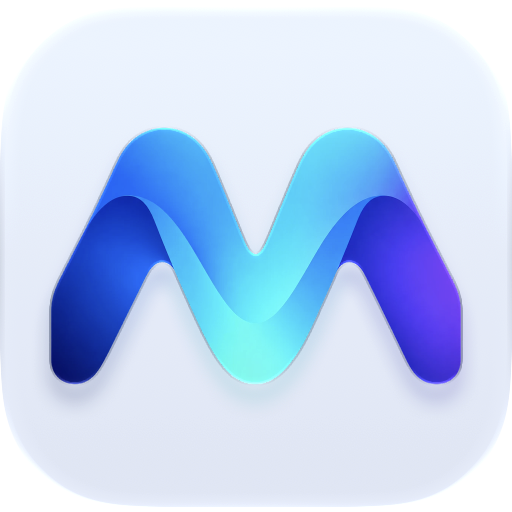
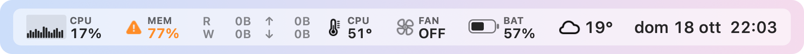
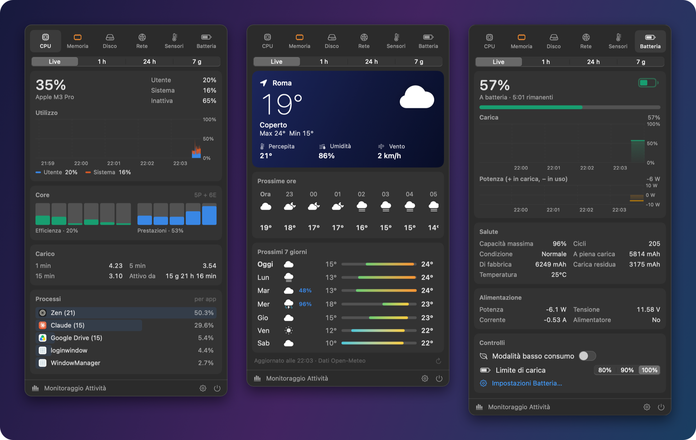
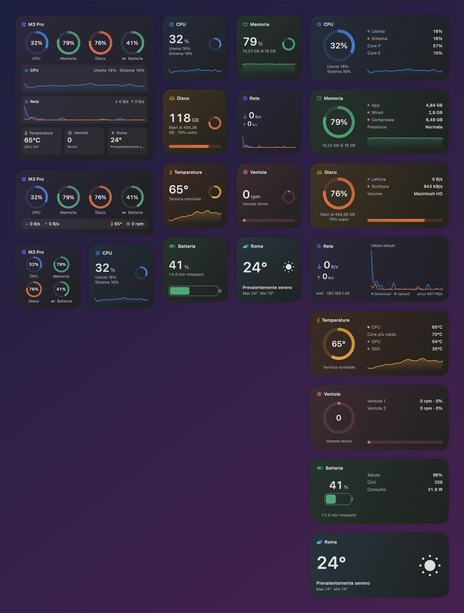
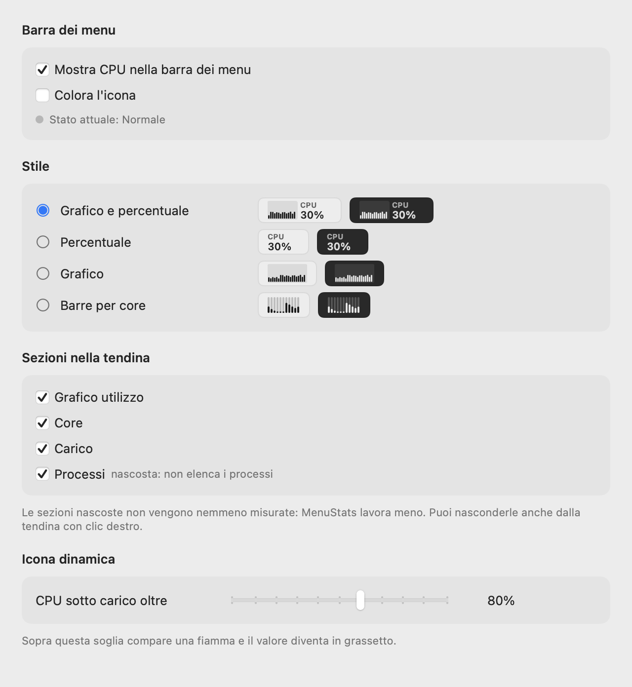
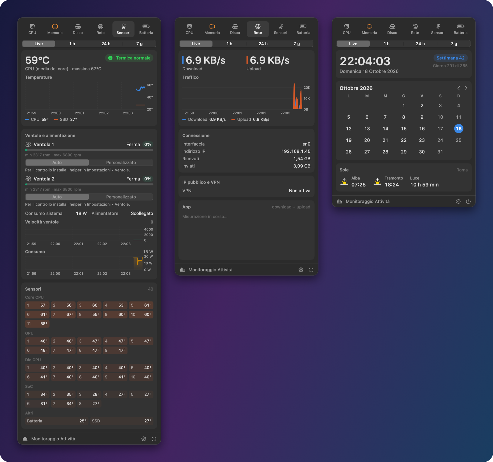
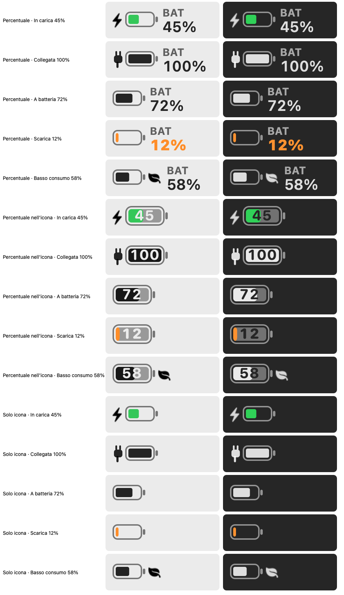
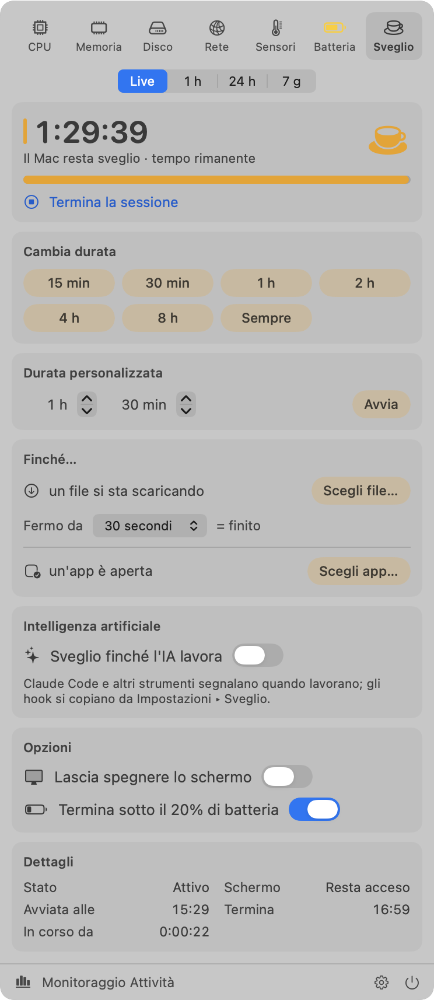
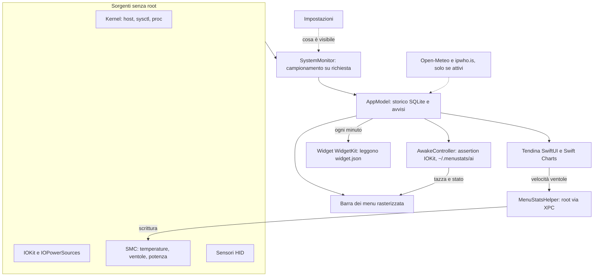

<div align="center">



# MenuStats

**Il tuo Mac, a colpo d'occhio.**<br>
Monitor di sistema per la barra dei menu di macOS: CPU, memoria, disco, rete, temperature, ventole, batteria,
meteo, data e un modulo per tenere il Mac sveglio. Compatto, preciso e leggero.

[](https://github.com/thomas-addamo/MenuStats/releases/latest)
[](https://github.com/thomas-addamo/MenuStats/releases)


### [⬇︎ Scarica MenuStats](https://github.com/thomas-addamo/MenuStats/releases/latest)

<picture>
  <source media="(prefers-color-scheme: dark)" srcset="docs/screenshots/hero-menubar-dark.png">
  
</picture>

</div>

<br>

<p align="center"></p>

## ✨ In breve

- **Tutto in una voce sola**: i moduli scelti stanno in un'unica voce compatta, con etichette piccole sopra i
  valori. Si può avere anche una voce per modulo.
- **Una tendina per ogni modulo**: grafici Live, 1 h, 24 h e 7 giorni, processi raggruppati per app, sensori,
  ventole, salute della batteria, volumi e traffico per app.
- **Icone che reagiscono**: la ventola gira quando le ventole girano, compare una fiamma con la CPU sotto carico,
  il termometro sale, la tazza fuma quando il Mac è tenuto sveglio e i colori passano da giallo ad arancione a rosso
  quando serve attenzione.
- **Sveglio quando serve**: per un tempo a scelta, finché un file si scarica, finché un'app è aperta o finché
  un'IA (Claude Code e simili) sta lavorando.
- **Valori verificati**: `--verify` confronta 18 valori con gli strumenti di macOS. La temperatura CPU è la
  stessa che mostra iStat Menus.
- **Leggero davvero**: circa l'1% di un core a riposo. Legge spesso solo ciò che stai guardando.
- **Sempre visibile, anche col notch**: MenuStats resta accanto all'orologio, così sono le altre icone a finire
  dietro la freccia di macOS. Se lo spazio non basta comunque, toglie le etichette e gli ultimi moduli finché ci sta.
- **Tuo**: stile per ogni modulo, colori, ordine, sezioni della tendina da mostrare o nascondere.
- **Widget**: memoria, disco, batteria e meteo sulla scrivania e nel Centro Notifiche, anche con l'app chiusa.
- **Si aggiorna da solo**: quando esce una nuova versione compare un'icona nella barra dei menu; un clic e
  MenuStats si scarica, si verifica e si reinstalla, senza comandi e senza un nuovo "Apri comunque".

## 📥 Installazione

1. Scarica `MenuStats-<versione>.zip` dall'[ultima release](https://github.com/thomas-addamo/MenuStats/releases/latest)
   e sposta **MenuStats.app** in `Applicazioni`.
2. L'app non è notarizzata: al primo avvio **clic destro ▸ Apri**. In alternativa:
   ```bash
   xattr -dr com.apple.quarantine /Applications/MenuStats.app
   ```
3. Da qui in poi gli aggiornamenti arrivano dall'app: Impostazioni ▸ **Aggiornamenti** (controllo automatico ogni
   6 ore, attivo di serie).
4. Facoltativo, per controllare le ventole o restare svegli a coperchio chiuso: Impostazioni ▸ **Ventole** (o
   **Sveglio**) ▸ *Installa helper*, poi consenti MenuStats
   in Impostazioni di Sistema ▸ Generali ▸ **Elementi login**.

> **Requisiti**: Mac con Apple Silicon e macOS 13 o successivo (macOS 14 per i widget della scrivania). Sviluppato e verificato su MacBook Pro M3 Pro con
> macOS 27; i sensori dell'M4 Pro sono stati confrontati con iStat Menus.

## 🧩 Moduli

| | In barra | Nella tendina |
|---|---|---|
| **CPU** | grafico + percentuale, barre per core | utilizzo utente/sistema, core efficienza e prestazioni, carico, processi |
| **Memoria** | anello, percentuale, usata, pressione | composizione (app, wired, compressa, cache), swap, processi |
| **Disco** | lettura/scrittura, spazio libero | volumi (usato / eliminabile / libero), attività, processi |
| **Rete** | upload/download, totale | traffico, connessione, **IP pubblico e VPN** con bandiera, app che usano la rete |
| **Temperature** | CPU (media dei core), massima, SSD, batteria | ogni core della CPU e della GPU, SoC, SSD, stato termico |
| **Ventole** | giri, percentuale, solo icona animata | velocità, controllo **Automatico / Personalizzato**, consumo del sistema |
| **Batteria** | percentuale, nell'icona, tempo, watt | carica, salute ufficiale Apple, cicli, potenza, **limite di carica**, basso consumo |
| **Meteo** · *facoltativo* | icona + temperatura | condizioni attuali, prossime 24 ore, 7 giorni con barre min/max |
| **Data e ora** · *facoltativo* | 7 disposizioni, 12/24 ore | calendario del mese, settimana, alba e tramonto |
| **Sveglio** · *facoltativo* | tazza con vapore, tempo rimanente | durata, durata personalizzata, finché un file si scarica, un'app è aperta o un'IA lavora; schermo acceso o libero, fine con batteria scarica |

La scheda **Mappa** mostra dove si trova il Mac e, sotto, **i tuoi dispositivi vicini**: accessori Bluetooth associati
(AirPods, tastiere, mouse, controller) e gli iPhone, iPad e Apple Watch che macOS riconosce, su un radar con la distanza stimata
dal segnale. Sono solo i dispositivi che macOS già conosce (la stessa lista di Impostazioni di Sistema ▸ Bluetooth):
MenuStats non cerca né mostra dispositivi di altre persone. Il Bluetooth dà la distanza, non la direzione. Il radar si
può nascondere da Impostazioni ▸ Mappa; l'elenco con le distanze resta. Sotto c'è l'interruttore del blocco automatico
(vedi sotto), già regolato come in Impostazioni.

**Blocca il Mac se mi allontano** (Impostazioni ▸ Mappa, spento di default): scegli uno o più dei tuoi dispositivi, per
esempio iPhone o Apple Watch, e un tempo di attesa (da 2 secondi a 5 minuti). Quando non li sente più per quel tempo, il
Mac si blocca, come con Control-Comando-Q, senza permessi in più. Funziona sempre, anche a scheda chiusa, con una lettura
ogni 1-60 secondi, secondo il tempo scelto, a costo quasi nullo. Un dispositivo conta solo dopo che è stato visto; dopo il blocco non scatta di
nuovo finché un dispositivo scelto non torna vicino, così sbloccare a mano non crea un ciclo di blocchi. Con più
dispositivi scegli se blocca quando se ne allontana uno qualsiasi o tutti. Puoi anche impostare una **distanza massima in
metri**: un dispositivo oltre quel limite conta come lontano, e accanto a ogni dispositivo vedi la distanza "ora" per
tarare il valore. La distanza è una stima dal segnale e può sbagliare di diversi metri; macOS aggiorna il segnale di
ogni dispositivo solo ogni pochi secondi, quindi i tempi molto brevi (2-5 secondi) non reagiscono davvero più in fretta e
possono bloccare il Mac per un calo momentaneo.

Su Mac senza ventole (MacBook Air) o senza batteria (desktop) i moduli che non servono si nascondono da soli.
Clic su un modulo: si apre la sua scheda. Clic destro: Impostazioni, Monitoraggio Attività, Esci.

## 🧱 Widget

Widget per la scrivania e il Centro Notifiche, in formato piccolo e medio: **Memoria**, **Disco**, **Batteria**,
**Meteo** e la **Panoramica** con tutti e quattro. Fai clic destro sulla scrivania ▸ **Modifica widget…** e cerca
*MenuStats*. In Impostazioni ▸ **Widget** trovi l'anteprima di ognuno con i tuoi dati.

<p align="center"></p>

<details>
<summary><b>Perché solo questi, e come funzionano</b></summary>
<br>

- macOS decide quando ridisegnare un widget: nella pratica ogni 1-2 minuti nel caso migliore, anche se l'app
  chiede di più. Per questo i widget mostrano solo valori che cambiano lentamente. CPU, rete, temperature e
  ventole restano nella barra dei menu, che si aggiorna ogni 2 secondi.
- Sono un'estensione WidgetKit in Swift e SwiftUI, in sandbox. Leggono da soli memoria, disco e batteria, quindi
  **funzionano anche con MenuStats chiuso**.
- Il meteo, il grafico della memoria nell'ultima ora e la salute ufficiale della batteria arrivano dall'app, che
  li scrive ogni minuto in `~/Library/Application Support/MenuStats/widget.json`. È l'unica cartella che
  l'estensione può leggere.

</details>

## 🔄 Aggiornamenti

Ogni push su `main` che cambia l'app (commit diretti e pull request unite) pubblica da solo una nuova
[release](https://github.com/thomas-addamo/MenuStats/releases) con GitHub Actions, dopo aver superato i test. MenuStats la trova (controllo
ogni 6 ore, o *Controlla ora*) e mostra un'icona ⬇︎ nella barra dei menu che apre Impostazioni ▸ Aggiornamenti.
*Scarica e installa*:

1. scarica lo zip della release da GitHub;
2. ne confronta l'impronta SHA-256 con quella pubblicata da GitHub;
3. controlla che dentro ci sia MenuStats, con una firma valida e una versione più recente;
4. chiude l'app, sostituisce il contenuto del pacchetto al suo posto e la riapre. Impostazioni, storico, avvio al
   login e helper delle ventole restano.

Un file scaricato dall'app non ha il flag di quarantena, quindi macOS non chiede di nuovo "Apri comunque".

## 🎨 Personalizzazione

<table>
<tr>
<td width="58%"></td>
<td>

- **Stile per modulo**, con anteprima dal vivo in chiaro e scuro.
- **Ordine e moduli**: trascina per riordinare, attiva solo quelli che ti servono.
- **Colori di allerta** automatici, oppure un colore a scelta per ogni modulo.
- **Icone dinamiche** attivabili o disattivabili.
- **Sezioni della tendina** da nascondere, dalle Impostazioni o con clic destro.
  Una sezione nascosta non viene nemmeno misurata.
- **Notifiche** per CPU, temperatura, batteria e ventole.
- Intervallo di aggiornamento, °C/°F, apertura al login.

</td>
</tr>
</table>

## 🖼️ Galleria

<p align="center"></p>

<details>
<summary><b>Tutti gli stili della batteria</b></summary>
<br>
<p align="center"></p>
</details>

## ⚡ Efficienza

MenuStats legge spesso **solo ciò che è sullo schermo**:

- **Barra**: CPU, memoria, rete, disco e batteria a ogni aggiornamento, pochi microsecondi l'uno. Temperature e
  ventole dall'SMC solo se i loro moduli sono in barra, altrimenti ogni 10 secondi.
- **Tendina**: processi, volumi, tutti i sensori, GPU e traffico per app solo mentre la loro sezione è visibile.
- **Disegno**: la barra è rasterizzata e aggiornata solo quando i pixel cambiano. Il timer ha una tolleranza
  per raggruppare i risvegli e si ferma a schermi spenti.

| A riposo (MacBook Pro M3 Pro) | Prima dell'ottimizzazione | Ora |
|---|---|---|
| CPU | 2,3% di un core | **≈ 1%** |
| Ciclo di campionamento | 7,1 ms | **2,5 ms** ogni 2 s |
| Lettura sensori HID | 49 ms sul thread principale | **in background**, solo quelli necessari |

## ✅ Attendibilità

`swift run MenuStats --verify` confronta 18 valori con `top`, `sysctl`, `diskutil`, `route`, `ipconfig`, `pmset` e
Informazioni di Sistema, e stampa ✓ o ✗ per ognuno.

- **Temperatura CPU**: media dei sensori SMC dei singoli core, lo stesso calcolo di iStat Menus.
- **Disco**: "libero" è lo spazio realmente libero, come in `df` e diskutil. Lo spazio che macOS può liberare da
  solo è mostrato a parte come "eliminabile".
- **Batteria**: la capacità massima è quella di Apple, non una stima.
- **Attivo da**: tempo dall'avvio, stop incluso, come `uptime`.

## 🔒 Privacy

MenuStats non ha account, non raccoglie statistiche d'uso e non manda dati a nessuno, con queste sole
eccezioni, tutte **spente di default**:

| Funzione | Cosa esce dal Mac | Quando |
|---|---|---|
| Meteo | il nome cercato, poi le coordinate della città → [Open-Meteo](https://open-meteo.com) | modulo attivo, ogni 15 minuti |
| Meteo automatico | posizione arrotondata a circa 1 km (con il permesso di macOS) | solo in modalità automatica |
| Aggiornamenti | una richiesta all'API delle release di GitHub | ogni 6 ore (disattivabile), e il download solo quando lo chiedi |
| IP pubblico | una richiesta a ipwho.is (e api4.ipify.org per l'IPv4) | opzione attiva e scheda Rete aperta, al massimo ogni 5 minuti |

I dispositivi vicini della scheda Mappa si leggono sul Mac con `system_profiler`, senza scansionare il Bluetooth e senza
permessi aggiuntivi: a scheda aperta, oppure in background solo se accendi il blocco per distanza. Nulla viene salvato o
inviato. Il modulo Sveglio non usa la rete: legge soltanto la cartella `~/.menustats/ai` (file vuoti, vedi sotto) e le
dimensioni del file che scegli di seguire. Il rilevamento della VPN, i sensori, i processi e lo storico restano sul Mac. Lo storico è un database SQLite di
8 giorni in `~/Library/Application Support/MenuStats`.

## ☕ Sveglio

Il modulo facoltativo **Sveglio** (Impostazioni ▸ Sveglio, poi attivalo in barra) chiede a macOS di non andare in
stop per inattività, con le stesse *power assertion* del comando `caffeinate`: niente password, niente helper.
Mentre una sessione è attiva la tazza in barra si riempie e fuma.

<p align="center"></p>

- **Durata**: 15 min, 30 min, 1, 2, 4, 8 ore, senza fine, oppure un tempo personalizzato (ore e minuti).
- **Finché un file si scarica**: scegli il file, o la cartella `.download` di Safari. La sessione finisce quando la
  dimensione resta ferma per il tempo che indichi (da 10 secondi a 30 minuti) o quando il file sparisce.
  Se macOS espone l'avanzamento del download, la barra lo mostra.
- **Finché un'app è aperta**: scegli un'app in esecuzione; la sessione finisce quando la chiudi.
- **Finché l'IA lavora**: un interruttore che resta acceso. Il Mac resta sveglio mentre uno strumento IA lavora e poi
  lascia andare da solo (vedi sotto).
- Lo schermo può restare acceso o spegnersi, e la sessione può finire sotto una soglia di batteria.
- **Coperchio chiuso** (facoltativo, sui portatili): con l'helper con privilegi installato, durante una sessione il
  Mac resta sveglio anche a coperchio chiuso, come con `sudo pmset disablesleep 1`. Finché dura è sospeso anche Stop
  dal menu Apple. Lo stop torna attivo da solo a fine sessione, se MenuStats si chiude, va in crash o non risponde
  per 3 minuti, con stress termico, con la batteria sotto il 10% e al riavvio. Un `disablesleep` impostato a mano
  non viene toccato. Senza quest'opzione chiudere il coperchio mette il Mac in stop.

### Finché l'IA lavora

Ogni strumento IA segnala che sta lavorando creando un file in `~/.menustats/ai/` e lo cancella quando ha finito.
MenuStats controlla la cartella ogni 2 secondi, solo con l'interruttore acceso: finché c'è almeno un file recente il
Mac resta sveglio, quando l'ultimo sparisce lascia andare. Più sessioni in parallelo funzionano: ognuna ha il suo
file. Un file non rinnovato per il tempo scelto in Impostazioni (30 minuti di default) viene ignorato: serve quando
uno strumento si ferma senza avvisare, per esempio con Esc in Claude Code. Se termini a mano una sessione IA, la
stessa attività non la riavvia.

**Claude Code.** In Impostazioni ▸ Sveglio, **Copia hook per Claude Code**, poi incolla la sezione `hooks` in
`~/.claude/settings.json` (o in `.claude/settings.json` di un progetto). `UserPromptSubmit` e `PostToolUse` segnalano
che sta lavorando, `Stop` e `SessionEnd` che ha finito. L'id della sessione arriva a ogni hook come JSON e dà a ogni
sessione il suo file; viene ripulito da tutto tranne lettere, cifre, `-` e `_`:

```json
{
  "hooks": {
    "UserPromptSubmit": [
      {
        "hooks": [
          {
            "command": "s=$(sed -n 's/.*\"session_id\" *: *\"\\([^\"]*\\)\".*/\\1/p' | head -1 | tr -cd 'A-Za-z0-9_-'); f=\"$HOME/.menustats/ai/claude-${s:-x}\"; mkdir -p \"$HOME/.menustats/ai\" && touch \"$f\"",
            "type": "command"
          }
        ]
      }
    ],
    "PostToolUse": [
      {
        "hooks": [
          {
            "command": "s=$(sed -n 's/.*\"session_id\" *: *\"\\([^\"]*\\)\".*/\\1/p' | head -1 | tr -cd 'A-Za-z0-9_-'); f=\"$HOME/.menustats/ai/claude-${s:-x}\"; mkdir -p \"$HOME/.menustats/ai\" && touch \"$f\"",
            "type": "command"
          }
        ]
      }
    ],
    "Stop": [
      {
        "hooks": [
          {
            "command": "s=$(sed -n 's/.*\"session_id\" *: *\"\\([^\"]*\\)\".*/\\1/p' | head -1 | tr -cd 'A-Za-z0-9_-'); f=\"$HOME/.menustats/ai/claude-${s:-x}\"; rm -f \"$f\"",
            "type": "command"
          }
        ]
      }
    ],
    "SessionEnd": [
      {
        "hooks": [
          {
            "command": "s=$(sed -n 's/.*\"session_id\" *: *\"\\([^\"]*\\)\".*/\\1/p' | head -1 | tr -cd 'A-Za-z0-9_-'); f=\"$HOME/.menustats/ai/claude-${s:-x}\"; rm -f \"$f\"",
            "type": "command"
          }
        ]
      }
    ]
  }
}
```

**Altri strumenti.** Va bene qualsiasi strumento che può eseguire un comando quando comincia e quando finisce un
lavoro (hook, script, notifiche di fine attività, un alias). Scegli un nome per lo strumento:

```sh
# quando inizia (e, se può, ogni volta che lavora ancora)
mkdir -p ~/.menustats/ai && touch ~/.menustats/ai/nome-strumento
# quando finisce
rm -f ~/.menustats/ai/nome-strumento
```

Per un comando da terminale basta avvolgerlo: `touch ~/.menustats/ai/build; npm run build; rm -f ~/.menustats/ai/build`.
Uno strumento che avvisa solo della fine non basta, perché manca il segnale di inizio. App senza hook né comandi,
come il sito o l'app di ChatGPT, non si possono collegare così: per loro c'è "finché un'app è aperta".

## 🌀 Ventole e limite di carica

- **Ventole**: un piccolo helper con privilegi (`MenuStatsHelper`, registrato con `SMAppService`) imposta la
  velocità tra il minimo e il massimo di fabbrica. Accetta solo questa copia di MenuStats e rimette le ventole in
  automatico se l'app si chiude o va in crash, prima dello stop e con stress termico. Lo stesso helper tiene
  sveglio il Mac a coperchio chiuso per Sveglio.
- **Limite di carica**: usa il limite nativo di macOS (80–100%), applicato dal sistema anche in stop e dopo il
  riavvio. Non serve l'helper.

<details>
<summary><b>Dettagli tecnici</b></summary>

- Chiavi SMC scrivibili su Apple Silicon: `Ftst`, `F{n}Md`, `F{n}Tg`. `F{n}Mn` e `F{n}Mx` fanno da limiti.
- Scrittura tramite `MSSMCWrite` (`Sources/CIOKitPrivate/shim.c`), che rifiuta dimensioni diverse da quella della chiave.
- Comunicazione via XPC (`local.menustats.helper`, protocollo in `Sources/MenuStatsShared`), con requisito di firma
  sul client: cdhash con firma ad hoc, Team ID con Developer ID.
- Su macOS 27 le chiavi SMC di carica (`CH0B`, `CHTE`) non sono più accessibili: il limite passa dal framework di
  sistema PowerUI (`Sources/CIOKitPrivate/chargelimit.m`). Verifica con `pmset -g battlimit`.
- Coperchio chiuso: l'helper imposta la proprietà `SleepDisabled` di `IOPMrootDomain` (la stessa di
  `pmset disablesleep`, il kernel la accetta solo da root). Prima scrive un segnaposto in
  `/Library/Application Support/MenuStats/lid-awake`: se l'helper muore o manca la corrente, al riavvio (RunAtLoad)
  lo trova e rimette lo stop. L'app rinnova la richiesta ogni minuto; dopo 3 minuti senza rinnovo l'helper la lascia.
- Per distribuire su altri Mac senza riapprovare l'helper a ogni versione servono Developer ID e notarizzazione:
  `SIGN_IDENTITY="Developer ID Application: …" ./scripts/build-app.sh`.

</details>

## 🏗️ Architettura



| Area | Dove |
|---|---|
| Lettori dei dati | `Sources/MenuStats/Readers` |
| Campionamento su richiesta | `Sources/MenuStats/SystemMonitor.swift` |
| Barra dei menu | `Sources/MenuStats/UI/Menubar` |
| Tendina | `Sources/MenuStats/UI/Panel` |
| Impostazioni | `Sources/MenuStats/UI/Settings` |
| Sveglio (sessioni, file, app, IA) | `Sources/MenuStats/Model/AwakeController.swift`, `UI/Panel/AwakeTab.swift` |
| Widget (dati e viste condivise) | `Sources/MenuStatsWidgetUI` |
| Estensione WidgetKit | `Sources/MenuStatsWidgets` |
| Aggiornamenti | `Sources/MenuStats/Model/Updater.swift`, `.github/workflows/release.yml` |
| Helper ventole | `Sources/MenuStatsHelper`, `Sources/MenuStatsShared` |
| SMC, HID, limite di carica (C/Objective-C) | `Sources/CIOKitPrivate` |

## 🛠️ Compilare e strumenti

Serve Xcode 26 o successivo, che compila anche l'icona Liquid Glass con `actool`.

```bash
git clone https://github.com/thomas-addamo/MenuStats.git && cd MenuStats
./scripts/install.sh                       # compila, installa in ~/Applications e avvia
```

| Comando | A cosa serve |
|---|---|
| `./scripts/test.sh` | test unitari, letture dei widget confrontate con macOS, estensione, versioni delle release |
| `swift run MenuStats --verify` | confronta i valori con gli strumenti di macOS |
| `swift run MenuStats --dump` | stampa una lettura di tutto |
| `swift run -c release MenuStats --benchmark` | costo di ogni lettore e del disegno |
| `swift run MenuStats --render-ui <cartella>` | PNG di barra, tendine e impostazioni, in chiaro e scuro |
| `MenuStats.app/Contents/MacOS/MenuStats --self-test <cartella>` | apre ogni tendina dell'app reale e la cattura |
| `MenuStats.app/Contents/MacOS/MenuStats --fan-test 0 3000` | prova la ventola 0 rileggendo le chiavi SMC |

## 🤝 Contribuire

Le pull request sono benvenute. Prima di aprirne una: `swift build` senza avvisi, `./scripts/test.sh` verde,
`--verify` a 18/18 e, per le
modifiche visive, uno sguardo a `--render-ui`. Quando una pull request viene unita parte da sola una nuova release
(versione patch; scrivi `[minor]` o `[major]` in un commit per alzare quelle, `[skip release]` per non pubblicare).
Grazie a chi ha già contribuito:

<a href="https://github.com/thomas-addamo/MenuStats/graphs/contributors">
  
</a>

- [@dany80213](https://github.com/dany80213): sensori M4 Pro, meteo con posizione automatica, IP pubblico e VPN
- [@alessandro-guttadauro](https://github.com/alessandro-guttadauro): Mac senza ventole, pulsante Esci

## 📌 Limiti noti

- Senza privilegi di amministratore si vedono solo i processi del proprio utente.
- La velocità personalizzata delle ventole è fissa: il firmware non la alza sotto carico, per questo l'helper torna
  in automatico con stress termico.
- Il limite di carica parte dall'80%, come in macOS.
- Con "una voce per modulo" la distanza tra le voci la decide macOS: la voce unica è più compatta.
- I dispositivi vicini hanno la distanza ma non la direzione, e la stima può sbagliare di diversi metri (muri, corpo e
  tasche cambiano il segnale). iPhone, iPad e Apple Watch compaiono solo quando macOS ne misura il segnale e li riconosce. Le
  posizioni su mappa di Dov'è (iPhone, AirTag, amici) restano inaccessibili ad altre app.
- Il blocco per distanza è una comodità, non una sicurezza: il segnale Bluetooth può restare anche a distanza o sparire
  per un attimo, e cuffie e AirPods spariscono dal segnale quando li metti nella custodia (meglio iPhone o Apple Watch).
  Per bloccare usa `SACLockScreenImmediate` del framework di sistema `login` (API non documentata, come le altre
  usate dal progetto); se un macOS futuro la rimuove, ripiega sullo spegnimento dello schermo.
- Sveglio non tiene acceso il Mac a coperchio chiuso. Con "finché l'IA lavora", uno strumento interrotto senza
  avviso (Esc) libera il Mac solo allo scadere del tempo di tolleranza. "Finché un'app è aperta" segue le app con
  finestra, non i processi di sistema.

---

<sub>MenuStats è un progetto indipendente ispirato a iStat Menus: non contiene codice o risorse di Bjango e non è
affiliato a Bjango. Usa API private di macOS (SMC, sensori HID, PowerUI) che potrebbero cambiare con gli
aggiornamenti di sistema.</sub>
