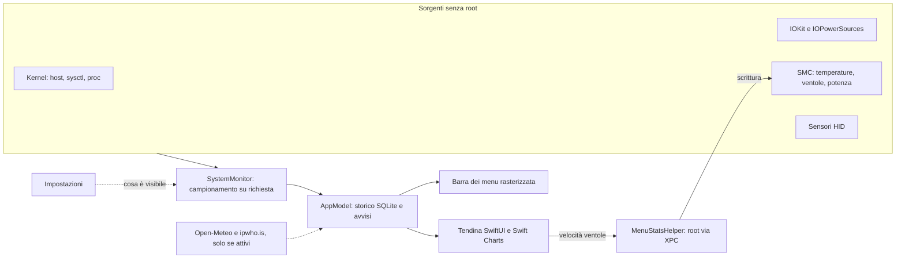

<div align="center">


# MenuStats

**Il tuo Mac, a colpo d'occhio.**<br>
Monitor di sistema per la barra dei menu di macOS: CPU, memoria, disco, rete, temperature, ventole, batteria,
meteo e data. Compatto, preciso e leggero.

[](https://github.com/thomas-addamo/MenuStats/releases/latest)
[](https://github.com/thomas-addamo/MenuStats/releases)


### [⬇︎ Scarica MenuStats](https://github.com/thomas-addamo/MenuStats/releases/latest)

<picture>
  <source media="(prefers-color-scheme: dark)" srcset="docs/screenshots/hero-menubar-dark.png">
  
</picture>

</div>

<br>

<p align="center"></p>

## ✨ In breve

- **Tutto in una voce sola**: i moduli scelti stanno in un'unica voce compatta, con etichette piccole sopra i
  valori. Si può avere anche una voce per modulo.
- **Una tendina per ogni modulo**: grafici Live, 1 h, 24 h e 7 giorni, processi raggruppati per app, sensori,
  ventole, salute della batteria, volumi e traffico per app.
- **Icone che reagiscono**: la ventola gira quando le ventole girano, compare una fiamma con la CPU sotto carico,
  il termometro sale e i colori passano da giallo ad arancione a rosso quando serve attenzione.
- **Valori verificati**: `--verify` confronta 18 valori con gli strumenti di macOS. La temperatura CPU è la
  stessa che mostra iStat Menus.
- **Leggero davvero**: circa l'1% di un core a riposo. Legge spesso solo ciò che stai guardando.
- **Tuo**: stile per ogni modulo, colori, ordine, sezioni della tendina da mostrare o nascondere.

## 📥 Installazione

1. Scarica `MenuStats-<versione>.zip` dall'[ultima release](https://github.com/thomas-addamo/MenuStats/releases/latest)
   e sposta **MenuStats.app** in `Applicazioni`.
2. L'app non è notarizzata: al primo avvio **clic destro ▸ Apri**. In alternativa:
   ```bash
   xattr -dr com.apple.quarantine /Applications/MenuStats.app
   ```
3. Facoltativo, per controllare le ventole: Impostazioni ▸ **Ventole** ▸ *Installa helper*, poi consenti MenuStats
   in Impostazioni di Sistema ▸ Generali ▸ **Elementi login**.

> **Requisiti**: Mac con Apple Silicon e macOS 13 o successivo. Sviluppato e verificato su MacBook Pro M3 Pro con
> macOS 27; i sensori dell'M4 Pro sono stati confrontati con iStat Menus.

## 🧩 Moduli

| | In barra | Nella tendina |
|---|---|---|
| **CPU** | grafico + percentuale, barre per core | utilizzo utente/sistema, core efficienza e prestazioni, carico, processi |
| **Memoria** | anello, percentuale, usata, pressione | composizione (app, wired, compressa, cache), swap, processi |
| **Disco** | lettura/scrittura, spazio libero | volumi (usato / eliminabile / libero), attività, processi |
| **Rete** | upload/download, totale | traffico, connessione, **IP pubblico e VPN** con bandiera, app che usano la rete |
| **Temperature** | CPU (media dei core), massima, SSD, batteria | ogni core della CPU e della GPU, SoC, SSD, stato termico |
| **Ventole** | giri, percentuale, solo icona animata | velocità, controllo **Automatico / Personalizzato**, consumo del sistema |
| **Batteria** | percentuale, nell'icona, tempo, watt | carica, salute ufficiale Apple, cicli, potenza, **limite di carica**, basso consumo |
| **Meteo** · *facoltativo* | icona + temperatura | condizioni attuali, prossime 24 ore, 7 giorni con barre min/max |
| **Data e ora** · *facoltativo* | 7 disposizioni, 12/24 ore | calendario del mese, settimana, alba e tramonto |

Su Mac senza ventole (MacBook Air) o senza batteria (desktop) i moduli che non servono si nascondono da soli.
Clic su un modulo: si apre la sua scheda. Clic destro: Impostazioni, Monitoraggio Attività, Esci.

## 🎨 Personalizzazione

<table>
<tr>
<td width="58%"></td>
<td>

- **Stile per modulo**, con anteprima dal vivo in chiaro e scuro.
- **Ordine e moduli**: trascina per riordinare, attiva solo quelli che ti servono.
- **Colori di allerta** automatici, oppure un colore a scelta per ogni modulo.
- **Icone dinamiche** attivabili o disattivabili.
- **Sezioni della tendina** da nascondere, dalle Impostazioni o con clic destro.
  Una sezione nascosta non viene nemmeno misurata.
- **Notifiche** per CPU, temperatura, batteria e ventole.
- Intervallo di aggiornamento, °C/°F, apertura al login.

</td>
</tr>
</table>

## 🖼️ Galleria

<p align="center"></p>

<details>
<summary><b>Tutti gli stili della batteria</b></summary>
<br>
<p align="center"></p>
</details>

## ⚡ Efficienza

MenuStats legge spesso **solo ciò che è sullo schermo**:

- **Barra**: CPU, memoria, rete, disco e batteria a ogni aggiornamento, pochi microsecondi l'uno. Temperature e
  ventole dall'SMC solo se i loro moduli sono in barra, altrimenti ogni 10 secondi.
- **Tendina**: processi, volumi, tutti i sensori, GPU e traffico per app solo mentre la loro sezione è visibile.
- **Disegno**: la barra è rasterizzata e aggiornata solo quando i pixel cambiano. Il timer ha una tolleranza
  per raggruppare i risvegli e si ferma a schermi spenti.

| A riposo (MacBook Pro M3 Pro) | Prima dell'ottimizzazione | Ora |
|---|---|---|
| CPU | 2,3% di un core | **≈ 1%** |
| Ciclo di campionamento | 7,1 ms | **2,5 ms** ogni 2 s |
| Lettura sensori HID | 49 ms sul thread principale | **in background**, solo quelli necessari |

## ✅ Attendibilità

`swift run MenuStats --verify` confronta 18 valori con `top`, `sysctl`, `diskutil`, `route`, `ipconfig`, `pmset` e
Informazioni di Sistema, e stampa ✓ o ✗ per ognuno.

- **Temperatura CPU**: media dei sensori SMC dei singoli core, lo stesso calcolo di iStat Menus.
- **Disco**: "libero" è lo spazio realmente libero, come in `df` e diskutil. Lo spazio che macOS può liberare da
  solo è mostrato a parte come "eliminabile".
- **Batteria**: la capacità massima è quella di Apple, non una stima.
- **Attivo da**: tempo dall'avvio, stop incluso, come `uptime`.

## 🔒 Privacy

MenuStats non ha account, non raccoglie statistiche d'uso e non manda dati a nessuno, con queste sole
eccezioni, tutte **spente di default**:

| Funzione | Cosa esce dal Mac | Quando |
|---|---|---|
| Meteo | il nome cercato, poi le coordinate della città → [Open-Meteo](https://open-meteo.com) | modulo attivo, ogni 15 minuti |
| Meteo automatico | posizione arrotondata a circa 1 km (con il permesso di macOS) | solo in modalità automatica |
| IP pubblico | una richiesta a ipwho.is (e api4.ipify.org per l'IPv4) | opzione attiva e scheda Rete aperta, al massimo ogni 5 minuti |

Il rilevamento della VPN, i sensori, i processi e lo storico restano sul Mac. Lo storico è un database SQLite di
8 giorni in `~/Library/Application Support/MenuStats`.

## 🌀 Ventole e limite di carica

- **Ventole**: un piccolo helper con privilegi (`MenuStatsHelper`, registrato con `SMAppService`) imposta la
  velocità tra il minimo e il massimo di fabbrica. Accetta solo questa copia di MenuStats e rimette le ventole in
  automatico se l'app si chiude o va in crash, prima dello stop e con stress termico.
- **Limite di carica**: usa il limite nativo di macOS (80–100%), applicato dal sistema anche in stop e dopo il
  riavvio. Non serve l'helper.

<details>
<summary><b>Dettagli tecnici</b></summary>

- Chiavi SMC scrivibili su Apple Silicon: `Ftst`, `F{n}Md`, `F{n}Tg`. `F{n}Mn` e `F{n}Mx` fanno da limiti.
- Scrittura tramite `MSSMCWrite` (`Sources/CIOKitPrivate/shim.c`), che rifiuta dimensioni diverse da quella della chiave.
- Comunicazione via XPC (`local.menustats.helper`, protocollo in `Sources/MenuStatsShared`), con requisito di firma
  sul client: cdhash con firma ad hoc, Team ID con Developer ID.
- Su macOS 27 le chiavi SMC di carica (`CH0B`, `CHTE`) non sono più accessibili: il limite passa dal framework di
  sistema PowerUI (`Sources/CIOKitPrivate/chargelimit.m`). Verifica con `pmset -g battlimit`.
- Per distribuire su altri Mac senza riapprovare l'helper a ogni versione servono Developer ID e notarizzazione:
  `SIGN_IDENTITY="Developer ID Application: …" ./scripts/build-app.sh`.

</details>

## 🏗️ Architettura



| Area | Dove |
|---|---|
| Lettori dei dati | `Sources/MenuStats/Readers` |
| Campionamento su richiesta | `Sources/MenuStats/SystemMonitor.swift` |
| Barra dei menu | `Sources/MenuStats/UI/Menubar` |
| Tendina | `Sources/MenuStats/UI/Panel` |
| Impostazioni | `Sources/MenuStats/UI/Settings` |
| Helper ventole | `Sources/MenuStatsHelper`, `Sources/MenuStatsShared` |
| SMC, HID, limite di carica (C/Objective-C) | `Sources/CIOKitPrivate` |

## 🛠️ Compilare e strumenti

Serve Xcode 26 o successivo, che compila anche l'icona Liquid Glass con `actool`.

```bash
git clone https://github.com/thomas-addamo/MenuStats.git && cd MenuStats
./scripts/install.sh                       # compila, installa in ~/Applications e avvia
```

| Comando | A cosa serve |
|---|---|
| `swift run MenuStats --verify` | confronta i valori con gli strumenti di macOS |
| `swift run MenuStats --dump` | stampa una lettura di tutto |
| `swift run -c release MenuStats --benchmark` | costo di ogni lettore e del disegno |
| `swift run MenuStats --render-ui <cartella>` | PNG di barra, tendine e impostazioni, in chiaro e scuro |
| `MenuStats.app/Contents/MacOS/MenuStats --self-test <cartella>` | apre ogni tendina dell'app reale e la cattura |
| `MenuStats.app/Contents/MacOS/MenuStats --fan-test 0 3000` | prova la ventola 0 rileggendo le chiavi SMC |

## 🤝 Contribuire

Le pull request sono benvenute. Prima di aprirne una: `swift build` senza avvisi, `--verify` a 18/18 e, per le
modifiche visive, uno sguardo a `--render-ui`. Grazie a chi ha già contribuito:

<a href="https://github.com/thomas-addamo/MenuStats/graphs/contributors">
  
</a>

- [@dany80213](https://github.com/dany80213): sensori M4 Pro, meteo con posizione automatica, IP pubblico e VPN
- [@alessandro-guttadauro](https://github.com/alessandro-guttadauro): Mac senza ventole, pulsante Esci

## 📌 Limiti noti

- Senza privilegi di amministratore si vedono solo i processi del proprio utente.
- La velocità personalizzata delle ventole è fissa: il firmware non la alza sotto carico, per questo l'helper torna
  in automatico con stress termico.
- Il limite di carica parte dall'80%, come in macOS.
- Con "una voce per modulo" la distanza tra le voci la decide macOS: la voce unica è più compatta.

---

<sub>MenuStats è un progetto indipendente ispirato a iStat Menus: non contiene codice o risorse di Bjango e non è
affiliato a Bjango. Usa API private di macOS (SMC, sensori HID, PowerUI) che potrebbero cambiare con gli
aggiornamenti di sistema.</sub>
